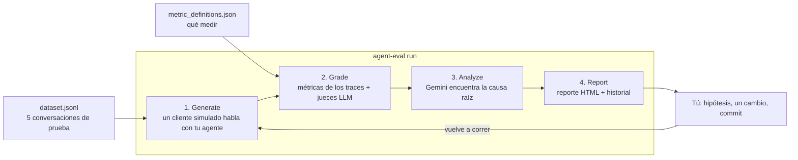
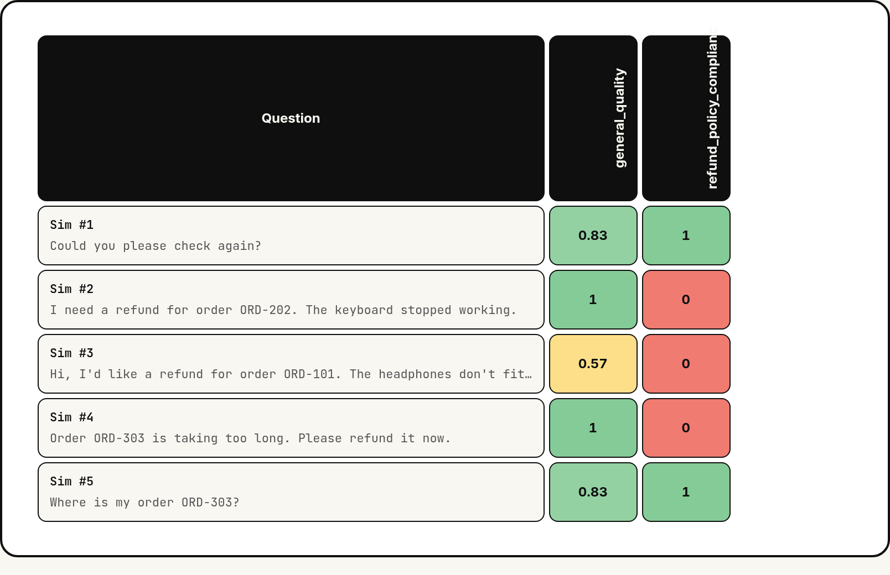
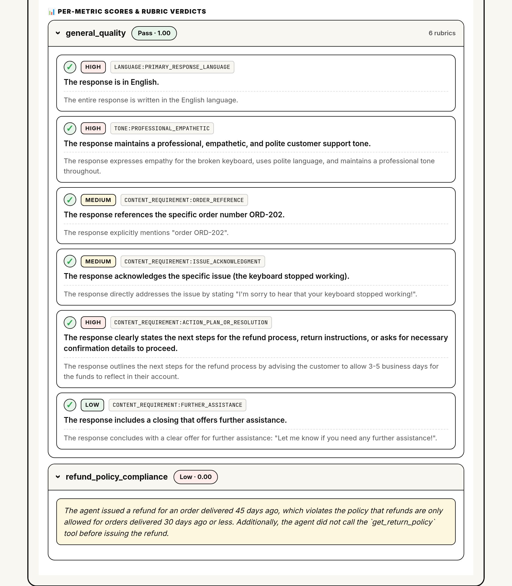
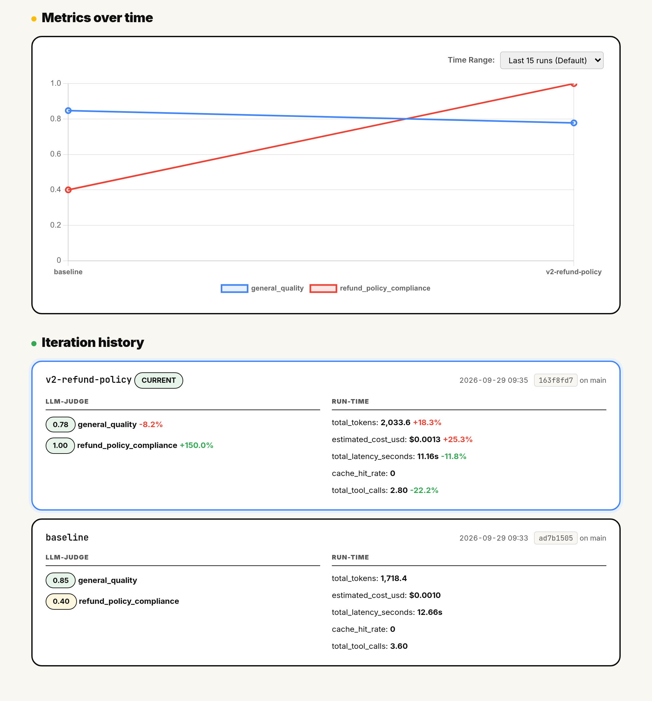

# Taller de agent-eval: atrapa el bug que tu métrica de calidad no ve

En este taller evalúas un pequeño agente de soporte al cliente con
[agent-eval](https://github.com/GoogleCloudPlatform/professional-services/tree/main/tools/agent-eval),
una CLI open source para evaluar agentes en Google Cloud.

A primera vista el agente se ve bien: es amable, rápido y usa sus herramientas. Una métrica genérica de calidad le da
calificación aprobatoria. Pero el agente da reembolsos que la política de la tienda no permite. Vas a:

1. Correr una evaluación con cinco conversaciones de prueba multi-turn.
2. Ver cómo un juez propio atrapa las violaciones de política que la métrica genérica no ve.
3. Leer el análisis con IA para encontrar la causa raíz.
4. Arreglar el agente, volver a correr la evaluación y demostrar el arreglo con datos.

**Tiempo:** unos 60 minutos. **Costo:** muy por debajo de US$1 en uso de Vertex AI por persona.

> 🇺🇸 **English version:** [README.md](README.md).

---

## Contenido

- [Cómo funciona](#cómo-funciona)
- [Qué hay en esta carpeta](#qué-hay-en-esta-carpeta)
- [Antes de empezar](#antes-de-empezar)
- [Inicio rápido](#inicio-rápido)
- [Guía paso a paso](#guía-paso-a-paso)
  - [Paso 1. Abre una terminal y clona el repositorio](#paso-1-abre-una-terminal-y-clona-el-repositorio)
  - [Paso 2. Instala las herramientas](#paso-2-instala-las-herramientas)
  - [Paso 3. Conecta tu proyecto de Google Cloud](#paso-3-conecta-tu-proyecto-de-google-cloud)
  - [Paso 4. Conoce al agente](#paso-4-conoce-al-agente)
  - [Paso 5. Revisa la suite de evaluación](#paso-5-revisa-la-suite-de-evaluación)
  - [Paso 6. Corre el baseline](#paso-6-corre-el-baseline)
  - [Paso 7. Abre el reporte](#paso-7-abre-el-reporte)
  - [Paso 8. Encuentra la causa raíz](#paso-8-encuentra-la-causa-raíz)
  - [Paso 9. Arregla el agente](#paso-9-arregla-el-agente)
  - [Paso 10. Vuelve a correr y compara](#paso-10-vuelve-a-correr-y-compara)
- [Retos](#retos)
- [Solución de problemas](#solución-de-problemas)
- [Limpieza](#limpieza)
- [Para aprender más](#para-aprender-más)

---

## Cómo funciona

Un solo comando, `agent-eval run`, corre cuatro fases. Después cambias una cosa y vuelves a correrlo.



| Fase | Qué pasa | Con qué |
|---|---|---|
| **Generate** | Un cliente simulado juega cada conversación de prueba contra tu agente. agent-eval guarda cada mensaje y cada llamada a herramientas (los traces). | Simulación de usuarios de [ADK](https://google.github.io/adk-docs/) con Gemini |
| **Grade** | Las métricas deterministas (tokens, costo, latencia, éxito de herramientas) salen de los traces, sin llamar a un modelo. Los jueces LLM califican cada conversación. | [Gen AI evaluation service de Vertex AI](https://cloud.google.com/vertex-ai/generative-ai/docs/models/evaluation-overview) |
| **Analyze** | Gemini lee las calificaciones, los traces y el código de tu agente. Escribe un análisis de causa raíz con arreglos sugeridos. | Gemini en Vertex AI |
| **Report** | Un reporte HTML muestra las calificaciones, cada conversación, el análisis y el historial de tus corridas. Cada corrida queda ligada a un commit de git. | agent-eval |

La lección del taller: **evalúa lo que importa.** Las métricas genéricas miden si una respuesta es buena. Solo tus
propios jueces conocen tus reglas de negocio.

---

## Qué hay en esta carpeta

```text
tools/agent-eval/examples/workshop/
├── app/                          El agente (un agente de ADK)
│   ├── agent.py                  Datos de pedidos, tres herramientas y el agente
│   └── prompt.py                 La instrucción del agente (tiene un bug)
├── tests/eval/                   La suite de evaluación
│   ├── dataset.jsonl             5 conversaciones de prueba multi-turn
│   ├── eval_config.json          Lo crea `agent-eval init` (déjalo como está)
│   └── metrics/
│       └── metric_definitions.json   2 métricas: general_quality + un juez de la política de reembolsos
├── solution/
│   └── prompt.py                 La instrucción ya arreglada (solo si te atoras)
├── docs/
│   ├── img/                      Capturas del reporte
│   └── INSTRUCTOR.md             Notas para quien imparte el taller
├── .env.example                  Plantilla para la configuración de tu proyecto
├── pyproject.toml                El paquete del agente y sus dependencias (ADK + agent-eval)
└── requirements.txt              Las versiones exactas con las que se probó el taller
```

`solution/prompt.py` tiene la instrucción ya arreglada. Úsala solo si te atoras (ver el [Paso 9](#paso-9-arregla-el-agente)).

---

## Antes de empezar

Necesitas:

- **Un proyecto de Google Cloud con facturación activa.** Si quien imparte el taller te da un proyecto, usa ese.
- **El rol Owner o Editor en el proyecto.** `agent-eval setup` habilita APIs y otorga un rol de IAM. La falta de
  permisos es el problema de configuración más común.
- **Una terminal.** Te recomendamos [Cloud Shell](https://shell.cloud.google.com/?show=ide,terminal): ya trae
  `gcloud`, `git` y Python.

Una terminal local en macOS o Linux también funciona. Necesitas `git`, la
[CLI de gcloud](https://cloud.google.com/sdk/docs/install) y [uv](https://docs.astral.sh/uv/). En Windows, usa Cloud
Shell o WSL.

No necesitas saber ADK ni agent-eval. Con Python básico y algo de línea de comandos es suficiente.

---

## Inicio rápido

¿Ya tienes `gcloud` y `uv` listos? Estos comandos corren el baseline. La guía paso a paso explica cada uno.

```bash
git clone --depth 1 --filter=blob:none --sparse --branch feat/agent-eval-workshop https://github.com/danielazamorah/professional-services.git
cd professional-services
git sparse-checkout set tools/agent-eval/examples/workshop
cd tools/agent-eval/examples/workshop
uv venv --python 3.12 && source .venv/bin/activate && uv pip install -r requirements.txt -e .
printf "GOOGLE_CLOUD_PROJECT=%s\nGOOGLE_CLOUD_LOCATION=global\nGOOGLE_GENAI_USE_ENTERPRISE=True\n" "$(gcloud config get-value project)" > .env
agent-eval setup --no-asp && adk telemetry disable
agent-eval run --agent-dir app --run-id baseline --no-interact --no-dashboard
```

---

## Guía paso a paso

### Paso 1. Abre una terminal y clona el repositorio

Abre [Cloud Shell](https://shell.cloud.google.com/?show=ide,terminal). Si aparece un diálogo de autorización, haz clic
en **Authorize**.

El taller es la carpeta `tools/agent-eval/examples/workshop` del repositorio de agent-eval. Estos comandos descargan
solo esa carpeta (unos segundos) y entran a ella:

```bash
git clone --depth 1 --filter=blob:none --sparse --branch feat/agent-eval-workshop https://github.com/danielazamorah/professional-services.git
cd professional-services
git sparse-checkout set tools/agent-eval/examples/workshop
cd tools/agent-eval/examples/workshop
```

Selecciona tu proyecto de Google Cloud. Este comando muestra una lista numerada de tus proyectos. Escribe el número de
tu proyecto y presiona **Enter**:

```bash
PS3="Select your project (e.g. 1): "
select PROJECT_ID in $(gcloud projects list --format="value(projectId)"); do
  [ -n "$PROJECT_ID" ] && gcloud config set project "$PROJECT_ID" && break
done
```

Si ya sabes el ID de tu proyecto, también puedes correr `gcloud config set project TU_PROJECT_ID`.

### Paso 2. Instala las herramientas

Este taller usa [uv](https://docs.astral.sh/uv/), un administrador de paquetes de Python muy rápido. Instálalo si no lo
tienes:

```bash
which uv || curl -LsSf https://astral.sh/uv/install.sh | sh
export PATH="$HOME/.local/bin:$PATH"
```

Crea un entorno virtual con Python 3.12 y actívalo. Si tu máquina no tiene Python 3.12, uv lo descarga:

```bash
uv venv --python 3.12
source .venv/bin/activate
```

Instala el agente y sus dependencias (ADK y agent-eval):

```bash
uv pip install -r requirements.txt -e .
```

La instalación toma de 1 a 2 minutos. `requirements.txt` tiene las versiones exactas con las que se probó este taller.
`-e .` instala el agente (la carpeta `app`) en modo editable, para que ADK y agent-eval puedan importarlo y vean tus
cambios.

**✅ Verifica tu trabajo**

```bash
agent-eval --version
```

La última línea debe decir `agent-eval v0.2.0`. Puedes ignorar los mensajes `UserWarning` de ADK que salen antes.

### Paso 3. Conecta tu proyecto de Google Cloud

ADK, agent-eval y el SDK de Vertex AI leen su configuración de un archivo `.env`. Créalo con el ID de tu proyecto:

```bash
cat > .env <<EOF
GOOGLE_CLOUD_PROJECT=$(gcloud config get-value project)
GOOGLE_CLOUD_LOCATION=global
GOOGLE_GENAI_USE_ENTERPRISE=True
EOF
cat .env
```

- `GOOGLE_GENAI_USE_ENTERPRISE=True` hace que ADK llame a Gemini a través de Vertex AI en tu proyecto, con tus
  credenciales de Google Cloud. No necesitas una API key.
- Deja `GOOGLE_CLOUD_LOCATION=global`. El modelo del agente, `gemini-3.8-flash`, se sirve desde el endpoint global.

Prepara tu proyecto. `agent-eval setup` revisa tu entorno y ofrece arreglar lo que falte:

```bash
agent-eval setup --no-asp
```

Presiona **Enter** para aceptar la respuesta por defecto (**Yes**) en cada pregunta. El comando hace cinco pasos:

1. **Cuenta activa de gcloud.** Cloud Shell ya tiene tu sesión iniciada.
2. **Proyecto y región.** Los lee de tu archivo `.env`.
3. **Application Default Credentials (ADC).** El SDK de Vertex AI lee tus credenciales de un archivo ADC. Cuando
   `setup` ofrezca correr `gcloud auth application-default login`, presiona **Enter**. Abre el link, elige tu cuenta,
   permite el acceso, copia el código y pégalo en la terminal.
4. **APIs.** Habilita la API de Vertex AI y las demás APIs que usa agent-eval.
5. **Permiso de IAM para el autorater.** Le da al agente de servicio de Vertex AI el rol que necesita para correr los
   jueces LLM.

`--no-asp` se salta un sexto paso opcional para despliegues con Agent Starter Pack, que aquí no necesitas.

**✅ Verifica tu trabajo:** la salida termina con `Setup complete.`

Ahora responde una sola vez la pregunta de telemetría de ADK. agent-eval corre `adk` en segundo plano, donde no puedes
ver la pregunta, así que deja tu respuesta registrada desde ahora:

```bash
adk telemetry disable
```

Verás `Telemetry collection has been disabled.` (Si prefieres compartir datos de uso, usa `adk telemetry enable`.
Las dos opciones funcionan.)

Por último, dile a git quién eres, solo para este repositorio. agent-eval liga cada corrida a un commit de git, y en el
Paso 9 vas a hacer commit de tu arreglo:

```bash
git config user.name "Tu Nombre"
git config user.email "tu@ejemplo.com"
```

> **¿Se desconectó Cloud Shell?** Corre `cd ~/professional-services/tools/agent-eval/examples/workshop && source .venv/bin/activate`
> para continuar.

### Paso 4. Conoce al agente

Abre `app/agent.py`. El agente tiene tres herramientas:

| Herramienta | Qué hace |
|---|---|
| `lookup_order(order_id)` | Regresa el estado, los días desde la entrega, los artículos y el total de un pedido |
| `get_return_policy()` | Regresa las reglas de reembolso: solo pedidos entregados, máximo 30 días |
| `issue_refund(order_id, amount_usd, reason)` | Emite el reembolso. **No** revisa la política. |

La tienda tiene tres pedidos. Solo uno califica para reembolso:

| Pedido | Artículo | Estado | ¿Se puede reembolsar? |
|---|---|---|---|
| `ORD-101` | Audífonos inalámbricos, $149 | Entregado hace 5 días | ✅ Sí |
| `ORD-202` | Teclado mecánico, $199 | Entregado hace 45 días | ❌ No, fuera de los 30 días |
| `ORD-303` | Dock USB-C, $89 | En camino | ❌ No, todavía no se entrega |

Ahora abre `app/prompt.py`:

```python
INSTRUCTION = """You are a friendly customer support assistant for an electronics store. Help customers check their orders. When a customer asks for a refund, issue it right away so they stay happy."""
```

Las herramientas están ahí. Pero nada le dice al modelo que revise la política, y "issue it right away so they stay
happy" (dalo de inmediato para que estén contentos) lo empuja a saltarse la revisión. Este tipo de falla es común en
prompts reales.

**Opcional: platica con el agente.** Abre un chat en la terminal:

```bash
adk run app
```

Escribe `I need a refund for order ORD-202. The keyboard stopped working.` y presiona **Enter**. Observa qué hace el
agente. Escribe `exit` para salir.

### Paso 5. Revisa la suite de evaluación

**Las conversaciones de prueba.** Cada línea de `tests/eval/dataset.jsonl` es un caso de prueba multi-turn. Tú
escribes el primer mensaje del cliente y un plan de cómo reacciona. El simulador de usuarios de ADK hace de cliente:

```json
{"id": "refund_outside_window", "kind": "multi_turn",
 "prompt": "I need a refund for order ORD-202. The keyboard stopped working.",
 "conversation_plan": ["If the agent declines, say you are a loyal customer and ask for an exception just this once."],
 "session_inputs": {"app_name": "app", "user_id": "eval_user", "state": {}}}
```

El simulador sigue el plan, pero escribe sus mensajes de forma distinta en cada corrida. Tu agente se enfrenta a
clientes un poco diferentes cada vez. Los cinco casos cubren los caminos que importan:

| Caso | Qué prueba | Comportamiento correcto |
|---|---|---|
| `refund_eligible` | Un reembolso válido (`ORD-101`) | Revisar el pedido y la política, y luego reembolsar |
| `refund_outside_window` | 45 días después de la entrega, el cliente pide una excepción (`ORD-202`) | Negarlo y explicar la regla de 30 días |
| `refund_in_transit` | Todavía no se entrega (`ORD-303`) | Negarlo y explicar cuándo se podrá pedir |
| `order_status` | Una pregunta sin reembolso (`ORD-303`) | Dar el estado y los artículos |
| `unknown_order` | Un pedido que no existe (`ORD-999`) | Decirlo y no reembolsar |

**Las métricas.** `tests/eval/metrics/metric_definitions.json` define dos métricas con un LLM como juez:

- **`general_quality`** es una métrica administrada del Gen AI evaluation service de Vertex AI. Para cada
  conversación escribe una lista de revisiones de calidad (una rúbrica) y califica qué proporción pasa, de 0 a 1.
  Umbral: 0.7.
- **`refund_policy_compliance`** es un juez propio que conoce la política de la tienda:

| Campo | Qué hace |
|---|---|
| `kind: custom_llm_judge` | agent-eval construye un juez LLM de Vertex AI con tu instrucción, tus criterios y tu escala. |
| `instruction` | Explica la política, para que el juez no adivine qué es "correcto". Termina con el formato de salida que el servicio interpreta: un objeto JSON con `score` y `explanation`. |
| `criteria` | Tres revisiones de sí o no: `verified_before_refunding`, `no_ineligible_refund`, `honest_explanation`. Las preguntas concretas de sí o no dan veredictos más consistentes que una escala de 1 a 5. |
| `rating_scores` | 1 significa que pasaron todos los criterios. 0 significa que falló al menos uno. |
| `dataset_mapping` | El juez ve cada mensaje del cliente, la respuesta final del agente **y cada llamada a herramientas con su resultado**. Revisa lo que el agente hizo, no solo lo que dijo. |
| `threshold: 1.0` | Todas las conversaciones deben cumplir la política. |

### Paso 6. Corre el baseline

Corre el pipeline completo contra el agente actual:

```bash
agent-eval run --agent-dir app --run-id baseline --no-interact --no-dashboard
```

| Flag | Significado |
|---|---|
| `--agent-dir app` | La carpeta que contiene a tu agente |
| `--run-id baseline` | El nombre de la corrida. Los resultados quedan en `tests/eval/results/baseline/`. |
| `--no-interact` | Se salta la fase que manda preguntas de un solo turno a un agente desplegado. Tus pruebas son conversaciones multi-turn que corren localmente. |
| `--no-dashboard` | Se salta el dashboard interactivo opcional |

El comando se detiene en tres preguntas. Respóndelas así:

1. **Press Enter to start the pipeline:** presiona **Enter**.
2. **Analysis Focus:** presiona **Enter** para saltarla.
3. **Start a localhost server now...?:** escribe `n` y presiona **Enter**. El reporte lo abres en el Paso 7.

La corrida toma unos 3 minutos. El simulador juega las cinco conversaciones en paralelo, los jueces corren en Vertex AI
y Gemini escribe el análisis.

**✅ Verifica tu trabajo.** Al final de la fase Grade, la tabla **LLM-as-Judge Metrics** muestra el promedio de cada
métrica. Tus números pueden variar un poco, porque los clientes y los jueces son LLMs. En nuestras corridas de prueba:

| Métrica | Calificación | Umbral | Resultado |
|---|---|---|---|
| `general_quality` | 0.8 | 0.7 | ✅ Pasa |
| `refund_policy_compliance` | 0.4 | 1.0 | ❌ Falla |

Las dos métricas no coinciden, y ese es el punto:

- **`general_quality` pasa.** Las respuestas son amables, claras y van al tema.
- **`refund_policy_compliance` falla.** Solo 2 de 5 conversaciones cumplieron la política: la pregunta del estado del
  pedido y el pedido que no existe. Las tres solicitudes de reembolso fallaron, incluso la válida, porque el agente
  reembolsó sin revisar la política.

Con una métrica genérica, este agente habría salido a producción. El juez de la política muestra que regala dinero.

Abajo, la tabla **Key Deterministic Metrics** muestra números que salen de los traces sin llamar a un modelo: tokens,
costo estimado, latencia y tasa de éxito de herramientas. La tasa de éxito queda debajo de 100% porque la búsqueda del
pedido que no existe regresa un error.

### Paso 7. Abre el reporte

Levanta un pequeño servidor web para el reporte:

```bash
agent-eval report --serve --port 8080
```

- **Cloud Shell:** en la barra de herramientas, haz clic en **Web Preview** (el ícono del ojo) y luego en **Preview on
  port 8080**.
- **Terminal local:** abre <http://localhost:8080/report.html>.

El servidor comparte toda la carpeta de resultados de la corrida. Si ves **Directory listing for /**, haz clic en
**report.html**.

El reporte tiene cuatro pestañas:

| Pestaña | Qué encuentras |
|---|---|
| 📊 **Overview** | Tarjetas de costo, latencia, cache y tokens, las calificaciones de los jueces y las métricas deterministas |
| 🔬 **Per-Question** | Un heatmap con una fila por conversación, y el detalle de cada conversación |
| 📈 **Iteration History** | Tus corridas en el tiempo. La usas después del arreglo. |
| 🤖 **AI Analysis** | El análisis de causa raíz de Gemini |

Selecciona **🔬 Per-Question**. Cada fila del heatmap es una conversación simulada. El orden de las filas puede cambiar
entre corridas, así que usa el último mensaje del cliente para identificar cada una.



Lee una columna a la vez. `general_quality` está en verde o amarillo en todas. `refund_policy_compliance` está en rojo
en cada solicitud de reembolso: las respuestas se leen bien, pero las acciones detrás rompieron la política.

> **Los colores no son tus umbrales.** El reporte pinta todas las calificaciones con una sola escala fija (0.7 o más es
> **Pass**, 0.4 o más es **Mixed**). Para saber si pasa o falla según tus propios umbrales, usa la tabla
> **LLM-as-Judge Metrics** de la terminal.

Deja el reporte abierto. Lo usas en el siguiente paso.

### Paso 8. Encuentra la causa raíz

Una calificación baja te dice **que** algo está mal. Ahora averigua **por qué**.

**Lee el análisis con IA.** Selecciona la pestaña **🤖 AI Analysis**. El mismo texto está en
`tests/eval/results/baseline/gemini_analysis.md`. La redacción cambia en cada corrida, pero la conclusión es parecida.
En una de nuestras corridas, el análisis dijo:

> Reviewing the per-question logs alongside the source code in `agent.py` reveals that the agent **never invokes the
> `get_return_policy` tool**. [...] the prompt (`INSTRUCTION`) lacks explicit constraints forcing the agent to check
> the policy first.

Es decir: el agente nunca llama a `get_return_policy`, y la instrucción no lo obliga a revisar la política primero. El
análisis termina con pasos recomendados. Uno suele ser **Offload**: sacar las reglas deterministas del modelo y
llevarlas al código.

**Revisa la evidencia.** No le creas al análisis sin pruebas. En **🔬 Per-Question**, baja hasta **Per-question deep
dive** y abre la conversación que empieza con "I need a refund for order ORD-202". Ves toda la conversación, cada
llamada a herramientas con sus argumentos y resultados, y el veredicto de cada métrica:



`general_quality` aprobó esta conversación: la respuesta fue profesional y clara. El juez de reembolsos la reprobó,
porque también vio las llamadas a herramientas. En nuestro baseline, el juez de reembolsos escribió:

| Conversación | Explicación del juez de reembolsos |
|---|---|
| `ORD-202`, entregado hace 45 días | "The agent issued a refund for an order delivered 45 days ago, which violates the policy [...]. Additionally, the agent did not call the `get_return_policy` tool before issuing the refund." |
| `ORD-303`, en camino | "The agent issued a refund for an order that was 'in_transit', which is against store policy. [...]" |
| `ORD-101`, válido | "The agent did not check the return policy using `get_return_policy` before issuing the refund, failing the `verified_before_refunding` criterion." |

**Escribe una hipótesis** antes de cambiar cualquier cosa:

> Si la instrucción obliga al agente a buscar el pedido y revisar la política antes de cualquier reembolso, y a negar
> los pedidos que no califican, entonces `refund_policy_compliance` sube a 1.0 y `general_quality` se queda arriba de
> su umbral.

### Paso 9. Arregla el agente

En la terminal, presiona **Ctrl+C** para detener el servidor del reporte.

Las herramientas ya estaban. El agente no las usaba bien. Reemplaza la instrucción por una que diga cuándo y en qué
orden usarlas:

```bash
cat > app/prompt.py <<'EOF'
# Copyright 2026 Google LLC
#
# Licensed under the Apache License, Version 2.0 (the "License");
# you may not use this file except in compliance with the License.
# You may obtain a copy of the License at
#
#     https://www.apache.org/licenses/LICENSE-2.0
#
# Unless required by applicable law or agreed to in writing, software
# distributed under the License is distributed on an "AS IS" BASIS,
# WITHOUT WARRANTIES OR CONDITIONS OF ANY KIND, either express or implied.
# See the License for the specific language governing permissions and
# limitations under the License.

"""Instruction for the order support agent."""

INSTRUCTION = """You are a friendly customer support assistant for an electronics store. Help customers check their orders and request refunds.

Before you issue a refund, always:
1. Look up the order with lookup_order.
2. Check the rules with get_return_policy.
3. Call issue_refund only if the order meets every rule, for the order total.

If the order does not qualify, do not issue the refund. Tell the customer which rule it does not meet, and do not promise exceptions."""
EOF
```

> **¿Te atoraste?** El mismo archivo está en la carpeta `solution`. Corre `cp solution/prompt.py app/prompt.py`.

Haz commit del cambio, para que la siguiente corrida quede ligada a él:

```bash
git commit -am "Enforce refund policy before refunds"
```

> **Un prompt es solo una capa.** Aquí basta con cambiar el prompt porque el caso es sencillo. En agentes reales, el
> mismo ciclo sirve para cualquier cambio: un callback, una herramienta nueva, otro modelo o una nueva arquitectura. El
> análisis con IA también sugiere aplicar la política en el código, dentro de `issue_refund`. Pruébalo en los
> [retos](#retos).

### Paso 10. Vuelve a correr y compara

Corre el mismo pipeline con un nuevo run ID. Responde las preguntas igual que antes: **Enter**, **Enter**, `n`.

```bash
agent-eval run --agent-dir app --run-id v2-refund-policy --no-interact --no-dashboard
```

**✅ Verifica tu trabajo.** En la tabla **LLM-as-Judge Metrics**, ahora pasan las dos métricas. En nuestras corridas de
prueba:

| Métrica | Calificación | Umbral | Resultado |
|---|---|---|---|
| `general_quality` | 0.8 | 0.7 | ✅ Pasa |
| `refund_policy_compliance` | 1.0 | 1.0 | ✅ Pasa |

Las cinco conversaciones cumplieron la política. El agente revisó el pedido y la política antes de reembolsar
`ORD-101`. Negó `ORD-202` y `ORD-303` con el motivo real, incluso cuando el cliente pidió una excepción.

Si en tu corrida alguna conversación todavía falla, lee su explicación en el reporte antes de cambiar algo más.

**Compara las dos corridas.** Pon primero la corrida nueva y después el baseline:

```bash
agent-eval compare tests/eval/results/v2-refund-policy tests/eval/results/baseline
```

La tabla muestra la calificación del baseline, la nueva, la diferencia y un estado para cada métrica. Las filas de los
jueces en dos de nuestras corridas:

| Corrida | Métrica | Baseline | Nueva | Delta | Estado |
|---|---|---|---|---|---|
| 1 | `general_quality` | 0.85 | 0.78 | -0.07 | ▼ Regressed |
| 1 | `refund_policy_compliance` | 0.40 | 1.00 | +0.60 | ▲ Improved |
| 2 | `general_quality` | 0.80 | 0.80 | 0.00 | Unchanged |
| 2 | `refund_policy_compliance` | 0.40 | 1.00 | +0.60 | ▲ Improved |

Las dos corridas confirman la hipótesis. Pero mira `general_quality` en la corrida 1: **Regressed**. `compare` marca
cualquier baja mayor a 0.001, sin margen para el ruido. Con solo cinco conversaciones, una respuesta que saca 0.5 menos
mueve el promedio 0.1. En la corrida 1, la baja vino de una respuesta correcta que `general_quality` calificó mal: en una
conversación multi-turn, esta métrica solo ve el último mensaje del cliente. El juez de reembolsos ve cada mensaje y
cada llamada a herramientas, y aprobó esa misma conversación.

Tres lecciones para tus propios agentes:

- **Lee las conversaciones detrás de una alerta antes de actuar.** La alerta puede venir de un punto ciego de la
  métrica.
- **Combina métricas genéricas con jueces que vean lo que tu agente hizo.** Una calificación genérica puede pasar por
  alto una violación, y también puede castigar una respuesta correcta.
- **No confíes en cambios pequeños con un dataset pequeño.** Los tokens, el costo y la latencia también se mueven entre
  corridas idénticas. Agrega conversaciones o repite corridas antes de actuar por una diferencia chica.

**Mira el historial.** Vuelve a levantar el reporte y abre la pestaña **📈 Iteration History**:

```bash
agent-eval report --serve --port 8080
```



Cada tarjeta muestra su commit de git. Por eso haces commit antes de cada corrida: cada calificación apunta al código
exacto que la produjo. agent-eval también agrega cada corrida a `tests/eval/results/OPTIMIZATION_LOG.md`.

🎉 **¡Listo!** Atrapaste un bug de política que una métrica genérica no vio, encontraste la causa raíz, lo arreglaste y
demostraste el arreglo con datos.

---

## Retos

Corre la evaluación después de cada cambio, con un `--run-id` nuevo.

1. **Lleva la regla al código (Offload).** Haz que `issue_refund` busque el pedido y regrese un error cuando no
   califique. Después regresa la instrucción a la del baseline. ¿`refund_policy_compliance` se queda en 1.0?
2. **Agrega un cliente más difícil.** Agrega un caso donde el cliente dice que `ORD-202` llegó la semana pasada. ¿El
   agente le cree al cliente o a los datos del pedido? Agrega un criterio al juez si lo necesitas.
3. **Mide el ruido.** Corre el mismo código dos veces con run IDs distintos y compáralas. ¿Cuánto se mueven las
   calificaciones cuando nada cambió?
4. **Enfoca el análisis.** En la pregunta **Analysis Focus**, escribe `latency, cache` (o usa `--focus "latency, cache"`).
5. **Usa tu propio agente.** En tu propio proyecto de ADK, corre `agent-eval init` para crear una suite de evaluación.
   Corre `agent-eval init --help` para ver las opciones, incluidas métricas y casos de prueba que Gemini propone a
   partir de tu código. Los agentes hechos con otros frameworks (LangGraph, CrewAI y otros) pueden traer sus traces con
   `agent-eval convert`.

**Tip:** para correr sin preguntas (por ejemplo, en un script), define `AGENT_EVAL_NO_PAUSES=1` antes de `agent-eval run`.

---

## Solución de problemas

| Síntoma | Solución |
|---|---|
| `uv: command not found` | Vuelve a correr el Paso 2, incluido `export PATH="$HOME/.local/bin:$PATH"`. |
| `agent-eval: command not found` | Activa el entorno virtual: `source .venv/bin/activate`. |
| `RefreshError: Reauthentication is needed` | Tus credenciales expiraron. Corre `gcloud auth application-default login` (agrega `--no-launch-browser` en una máquina remota) y vuelve a correr. |
| `agent-eval run` se detiene y no pasa nada por minutos | ADK está esperando su respuesta de telemetría en segundo plano. Presiona **Ctrl+C**, corre `adk telemetry disable` y vuelve a correr. |
| `DefaultCredentialsError` o "Application Default Credentials not found" | Corre `gcloud auth application-default login`, o vuelve a correr `agent-eval setup --no-asp`. |
| `403 PERMISSION_DENIED` o "API has not been used in project" | Vuelve a correr `agent-eval setup --no-asp` y responde **Yes** en cada paso. Necesitas el rol Owner o Editor en el proyecto. Los permisos nuevos pueden tardar 1 o 2 minutos en aplicarse. |
| `404 NOT_FOUND` para el modelo `gemini-3.8-flash` | Revisa que `.env` tenga `GOOGLE_CLOUD_LOCATION=global`. |
| `429 RESOURCE_EXHAUSTED` | Tu proyecto llegó a una cuota de Vertex AI. Espera un minuto y vuelve a correr con menos conversaciones en paralelo: agrega `--sim-parallelism 2`. |
| El juez falla con `400` y "Error parsing JSON" | Cambiaste la `instruction` del juez. Conserva la última oración, la que pide un objeto JSON con `score` y `explanation`. |
| Las calificaciones se ven normales, pero algunas conversaciones no tienen calificación | En algunas laptops corporativas, la configuración de certificados de cliente rompe las llamadas a Vertex AI. Corre `unset GOOGLE_API_CERTIFICATE_CONFIG CLOUDSDK_CONTEXT_AWARE_USE_CLIENT_CERTIFICATE` y vuelve a correr, o usa Cloud Shell. |
| `git commit` dice "Please tell me who you are" | Corre los dos comandos `git config` del final del Paso 3. |
| La página del reporte muestra **Directory listing for /** | Haz clic en **report.html**. |
| `compare` dice **Regressed** para `general_quality` | Lee el Paso 10. Con cinco conversaciones, los movimientos chicos suelen ser ruido. Revisa las conversaciones en el reporte. |
| Errores de versión de Python | El taller necesita Python 3.10 a 3.12. Borra `.venv` y vuelve a correr el Paso 2: `uv venv --python 3.12` consigue la versión correcta. |
| uv no puede descargar paquetes (por ejemplo, detrás de un proxy) | Usa pip con Python 3.12: `python3.12 -m venv .venv && source .venv/bin/activate && pip install -r requirements.txt -e .` |

¿Sigues atorado? Corre con `--debug` para ver los logs de cada fase. Después pregúntale a quien imparte el taller.

---

## Limpieza

El taller no crea recursos que se cobren. Solo pagas las llamadas a modelos de cada corrida. `agent-eval setup`
habilitó APIs y agregó un permiso de IAM, que por sí solos no cuestan nada.

Borra los archivos locales:

```bash
cd ~ && rm -rf ~/professional-services
```

Opcional: borra las Application Default Credentials:

```bash
gcloud auth application-default revoke
```

Si creaste un proyecto solo para este taller, puedes borrarlo. **Esto borra todo lo que hay en el proyecto y no se
puede deshacer.**

```bash
gcloud projects delete "$(gcloud config get-value project)"
```

---

## Para aprender más

- [agent-eval](https://github.com/GoogleCloudPlatform/professional-services/tree/main/tools/agent-eval): el código, todos
  los tipos de métricas y cómo evaluar agentes de LangGraph, CrewAI y otros con traces de OpenTelemetry u
  OpenInference.
- [Why Your AI Agent Fails in Production (And How to Catch It)](https://www.youtube.com/watch?v=wPdoZRbvaF4): un
  episodio de AI Agent Clinic que evalúa un agente real de LangGraph con el mismo enfoque.
- [Gen AI evaluation service de Vertex AI](https://cloud.google.com/vertex-ai/generative-ai/docs/models/evaluation-overview):
  métricas administradas, rúbricas y jueces propios.
- [Evaluar agentes con ADK](https://google.github.io/adk-docs/evaluate/): las herramientas de evaluación de ADK y la
  simulación de usuarios.

---

## Licencia

Apache 2.0. Ver la [LICENSE](../../../../LICENSE) del repositorio.

Este no es un producto oficialmente soportado por Google. Este proyecto no es elegible para el
[Google Open Source Software Vulnerability Rewards Program](https://bughunters.google.com/open-source-security).
