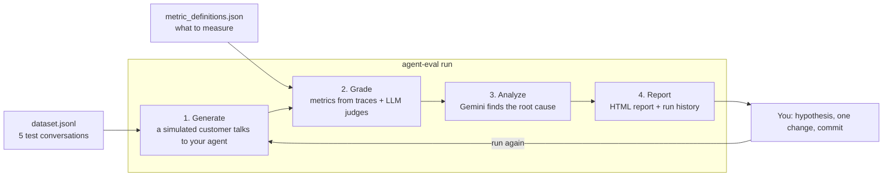

# agent-eval workshop: catch the bug your quality metric misses

In this workshop, you evaluate a small customer support agent with
[agent-eval](https://github.com/GoogleCloudPlatform/professional-services/tree/main/tools/agent-eval),
an open source CLI for evaluating agents on Google Cloud.

The agent looks fine at first. It is polite, fast, and it calls its tools. A generic quality metric gives it a passing
score. But the agent gives refunds that the store policy does not allow. You will:

1. Run an evaluation with five multi-turn test conversations.
2. See a custom judge catch the policy violations that the generic metric misses.
3. Read the AI analysis to find the root cause.
4. Fix the agent, run the evaluation again, and prove the fix with data.

**Time:** about 60 minutes. **Cost:** well under US$1 in Vertex AI usage per person.

> 🇲🇽 **¿Prefieres español?** Lee la guía en [README.es.md](README.es.md).

---

## Contents

- [How it works](#how-it-works)
- [What is in this folder](#what-is-in-this-folder)
- [Before you begin](#before-you-begin)
- [Quickstart](#quickstart)
- [Step-by-step guide](#step-by-step-guide)
  - [Step 1. Open a terminal and clone the repository](#step-1-open-a-terminal-and-clone-the-repository)
  - [Step 2. Install the tools](#step-2-install-the-tools)
  - [Step 3. Connect your Google Cloud project](#step-3-connect-your-google-cloud-project)
  - [Step 4. Meet the agent](#step-4-meet-the-agent)
  - [Step 5. Look at the evaluation suite](#step-5-look-at-the-evaluation-suite)
  - [Step 6. Run the baseline](#step-6-run-the-baseline)
  - [Step 7. Open the report](#step-7-open-the-report)
  - [Step 8. Find the root cause](#step-8-find-the-root-cause)
  - [Step 9. Fix the agent](#step-9-fix-the-agent)
  - [Step 10. Run again and compare](#step-10-run-again-and-compare)
- [Challenges](#challenges)
- [Troubleshooting](#troubleshooting)
- [Clean up](#clean-up)
- [Learn more](#learn-more)

---

## How it works

One command, `agent-eval run`, runs four phases. Then you change one thing and run it again.



| Phase | What happens | Powered by |
|---|---|---|
| **Generate** | A simulated customer plays each test conversation against your agent. agent-eval records every message and tool call (the traces). | [ADK](https://google.github.io/adk-docs/) user simulation with Gemini |
| **Grade** | Deterministic metrics (tokens, cost, latency, tool success) come from the traces, with no model calls. LLM judges score each conversation. | [Vertex AI Gen AI evaluation service](https://cloud.google.com/vertex-ai/generative-ai/docs/models/evaluation-overview) |
| **Analyze** | Gemini reads the scores, the traces, and your agent's source code. It writes a root cause analysis with suggested fixes. | Gemini on Vertex AI |
| **Report** | An HTML report shows the scores, every conversation, the analysis, and the history of your runs. Each run is tied to a git commit. | agent-eval |

The lesson of the workshop: **evaluate what matters.** Generic metrics measure if a reply is good. Only your own
judges know your business rules.

---

## What is in this folder

```text
tools/agent-eval/examples/workshop/
├── app/                          The agent (an ADK agent)
│   ├── agent.py                  Order data, three tools, and the agent
│   └── prompt.py                 The agent's instruction (it has a bug)
├── tests/eval/                   The evaluation suite
│   ├── dataset.jsonl             5 multi-turn test conversations
│   ├── eval_config.json          Created by `agent-eval init` (leave it as is)
│   └── metrics/
│       └── metric_definitions.json   2 metrics: general_quality + a refund policy judge
├── solution/
│   └── prompt.py                 The fixed instruction (only if you get stuck)
├── docs/
│   ├── img/                      Screenshots of the report
│   └── INSTRUCTOR.md             Notes for workshop instructors
├── .env.example                  Template for your project settings
├── pyproject.toml                The agent package and its dependencies (ADK + agent-eval)
└── requirements.txt              Exact versions that the workshop was tested with
```

`solution/prompt.py` holds the fixed instruction. Use it only if you get stuck (see [Step 9](#step-9-fix-the-agent)).

---

## Before you begin

You need:

- **A Google Cloud project with billing enabled.** If your instructor gives you a project, use that one.
- **The Owner or Editor role on the project.** `agent-eval setup` enables APIs and grants one IAM role. A missing
  permission is the most common setup problem.
- **A terminal.** We recommend [Cloud Shell](https://shell.cloud.google.com/?show=ide,terminal): it already has
  `gcloud`, `git`, and Python.

A local terminal on macOS or Linux also works. You need `git`, the
[gcloud CLI](https://cloud.google.com/sdk/docs/install), and [uv](https://docs.astral.sh/uv/). On Windows, use Cloud
Shell or WSL.

You do not need to know ADK or agent-eval. Basic Python and command line skills are enough.

---

## Quickstart

Already set up with `gcloud` and `uv`? These commands run the baseline. The step-by-step guide explains each one.

```bash
git clone --depth 1 --filter=blob:none --sparse --branch feat/agent-eval-workshop https://github.com/danielazamorah/professional-services.git
cd professional-services
git sparse-checkout set tools/agent-eval/examples/workshop
cd tools/agent-eval/examples/workshop
uv venv --python 3.12 && source .venv/bin/activate && uv pip install -r requirements.txt -e .
printf "GOOGLE_CLOUD_PROJECT=%s\nGOOGLE_CLOUD_LOCATION=global\nGOOGLE_GENAI_USE_ENTERPRISE=True\n" "$(gcloud config get-value project)" > .env
agent-eval setup --no-asp && adk telemetry disable
agent-eval run --agent-dir app --run-id baseline --no-interact --no-dashboard
```

---

## Step-by-step guide

### Step 1. Open a terminal and clone the repository

Open [Cloud Shell](https://shell.cloud.google.com/?show=ide,terminal). If a dialog asks you to authorize, click
**Authorize**.

The workshop is the `tools/agent-eval/examples/workshop` folder of the agent-eval repository. These commands download
only that folder (a few seconds) and go into it:

```bash
git clone --depth 1 --filter=blob:none --sparse --branch feat/agent-eval-workshop https://github.com/danielazamorah/professional-services.git
cd professional-services
git sparse-checkout set tools/agent-eval/examples/workshop
cd tools/agent-eval/examples/workshop
```

Select your Google Cloud project. This command shows a numbered list of your projects. Type the number of your
project and press **Enter**:

```bash
PS3="Select your project (e.g. 1): "
select PROJECT_ID in $(gcloud projects list --format="value(projectId)"); do
  [ -n "$PROJECT_ID" ] && gcloud config set project "$PROJECT_ID" && break
done
```

If you know your project ID, you can also run `gcloud config set project YOUR_PROJECT_ID`.

### Step 2. Install the tools

This workshop uses [uv](https://docs.astral.sh/uv/), a fast Python package manager. Install it if you do not have it:

```bash
which uv || curl -LsSf https://astral.sh/uv/install.sh | sh
export PATH="$HOME/.local/bin:$PATH"
```

Create a Python 3.12 virtual environment and activate it. uv downloads Python 3.12 if your machine does not have it:

```bash
uv venv --python 3.12
source .venv/bin/activate
```

Install the agent and its dependencies (ADK and agent-eval):

```bash
uv pip install -r requirements.txt -e .
```

The install takes 1 to 2 minutes. `requirements.txt` holds the exact versions that this workshop was tested with.
`-e .` installs the agent (the `app` folder) in editable mode, so that ADK and agent-eval can import it and see your
changes.

**✅ Check your work**

```bash
agent-eval --version
```

The last line of the output must be `agent-eval v0.2.0`. You can ignore `UserWarning` messages from ADK above it.

### Step 3. Connect your Google Cloud project

ADK, agent-eval, and the Vertex AI SDK read their settings from a `.env` file. Create it with your project ID:

```bash
cat > .env <<EOF
GOOGLE_CLOUD_PROJECT=$(gcloud config get-value project)
GOOGLE_CLOUD_LOCATION=global
GOOGLE_GENAI_USE_ENTERPRISE=True
EOF
cat .env
```

- `GOOGLE_GENAI_USE_ENTERPRISE=True` makes ADK call Gemini through Vertex AI in your project, with your Google Cloud
  credentials. You do not need an API key.
- Keep `GOOGLE_CLOUD_LOCATION=global`. The agent's model, `gemini-3.8-flash`, is served from the global endpoint.

Prepare your project. `agent-eval setup` checks your environment and offers to fix what is missing:

```bash
agent-eval setup --no-asp
```

Press **Enter** to accept the default answer (**Yes**) at each prompt. The command does five steps:

1. **Active gcloud account.** Cloud Shell is already signed in.
2. **Project and location.** Read from your `.env` file.
3. **Application Default Credentials (ADC).** The Vertex AI SDK reads your credentials from an ADC file. When
   `setup` offers to run `gcloud auth application-default login`, press **Enter**. Open the link, choose your account,
   allow access, copy the code, and paste it into the terminal.
4. **APIs.** Enables the Vertex AI API and the other APIs that agent-eval uses.
5. **Autorater IAM binding.** Gives the Vertex AI service agent the role that it needs to run LLM judges.

`--no-asp` skips an optional sixth step for Agent Starter Pack deployments, which you do not need here.

**✅ Check your work:** the output ends with `Setup complete.`

Now answer ADK's telemetry question once. agent-eval runs `adk` in the background, where you cannot see the question,
so record your choice now:

```bash
adk telemetry disable
```

You see `Telemetry collection has been disabled.` (Use `adk telemetry enable` if you prefer. Both work.)

Last, tell git who you are, for this repository only. agent-eval ties every run to a git commit, and you commit your
fix in Step 9:

```bash
git config user.name "Your Name"
git config user.email "you@example.com"
```

> **Cloud Shell disconnected?** Run `cd ~/professional-services/tools/agent-eval/examples/workshop && source .venv/bin/activate`
> to continue.

### Step 4. Meet the agent

Open `app/agent.py`. The agent has three tools:

| Tool | What it does |
|---|---|
| `lookup_order(order_id)` | Returns the status, delivery age, items, and total of an order |
| `get_return_policy()` | Returns the refund rules: delivered orders only, 30 days or less |
| `issue_refund(order_id, amount_usd, reason)` | Issues the refund. It does **not** check the policy. |

The store has three orders. Only one of them qualifies for a refund:

| Order | Item | Status | Refund allowed? |
|---|---|---|---|
| `ORD-101` | Wireless Headphones, $149 | Delivered 5 days ago | ✅ Yes |
| `ORD-202` | Mechanical Keyboard, $199 | Delivered 45 days ago | ❌ No, outside the 30-day window |
| `ORD-303` | USB-C Dock, $89 | In transit | ❌ No, not delivered yet |

Now open `app/prompt.py`:

```python
INSTRUCTION = """You are a friendly customer support assistant for an electronics store. Help customers check their orders. When a customer asks for a refund, issue it right away so they stay happy."""
```

The tools are all there. But nothing tells the model to check the policy, and "issue it right away so they stay
happy" pushes it to skip the check. This kind of flaw is common in real prompts.

**Optional: talk to the agent.** Start a chat in the terminal:

```bash
adk run app
```

Type `I need a refund for order ORD-202. The keyboard stopped working.` and press **Enter**. Watch what the agent
does. Type `exit` to stop.

### Step 5. Look at the evaluation suite

**The test conversations.** Each line of `tests/eval/dataset.jsonl` is one multi-turn test case. You write the
customer's first message and a plan for how the customer reacts. ADK's user simulator plays the customer:

```json
{"id": "refund_outside_window", "kind": "multi_turn",
 "prompt": "I need a refund for order ORD-202. The keyboard stopped working.",
 "conversation_plan": ["If the agent declines, say you are a loyal customer and ask for an exception just this once."],
 "session_inputs": {"app_name": "app", "user_id": "eval_user", "state": {}}}
```

The simulator follows the plan, but it words its messages differently on each run. Your agent meets slightly different
customers every time. The five cases cover the paths that matter:

| Case | What it tests | Correct behavior |
|---|---|---|
| `refund_eligible` | A valid refund (`ORD-101`) | Check the order and the policy, then refund |
| `refund_outside_window` | 45 days after delivery, the customer asks for an exception (`ORD-202`) | Decline and explain the 30-day rule |
| `refund_in_transit` | Not delivered yet (`ORD-303`) | Decline and explain when a refund becomes possible |
| `order_status` | A question with no refund (`ORD-303`) | Give the status and the items |
| `unknown_order` | An order that does not exist (`ORD-999`) | Say so and do not refund |

**The metrics.** `tests/eval/metrics/metric_definitions.json` defines two LLM-as-judge metrics:

- **`general_quality`** is a managed metric of the Vertex AI Gen AI evaluation service. For each conversation it
  writes a set of quality checks (a rubric) and scores the share of checks that pass, from 0 to 1. Threshold: 0.7.
- **`refund_policy_compliance`** is a custom judge that knows the store policy:

| Field | What it does |
|---|---|
| `kind: custom_llm_judge` | agent-eval builds a Vertex AI LLM judge from your instruction, criteria, and rating scores. |
| `instruction` | States the policy, so the judge does not guess what "correct" means. It ends with the output format that the service parses: a JSON object with `score` and `explanation`. |
| `criteria` | Three pass or fail checks: `verified_before_refunding`, `no_ineligible_refund`, `honest_explanation`. Narrow yes or no questions give more consistent verdicts than a 1 to 5 scale. |
| `rating_scores` | 1 means every criterion passed. 0 means at least one failed. |
| `dataset_mapping` | The judge sees every customer message, the agent's final reply, **and every tool call with its result**. It checks what the agent did, not only what it said. |
| `threshold: 1.0` | Every conversation must follow the policy. |

### Step 6. Run the baseline

Run the full pipeline against the current agent:

```bash
agent-eval run --agent-dir app --run-id baseline --no-interact --no-dashboard
```

| Flag | Meaning |
|---|---|
| `--agent-dir app` | The folder that holds your agent |
| `--run-id baseline` | The name of the run. Results go to `tests/eval/results/baseline/`. |
| `--no-interact` | Skips the phase that sends single-turn queries to a deployed agent. Your tests are multi-turn conversations that run locally. |
| `--no-dashboard` | Skips the optional interactive dashboard |

The command stops at three prompts. Answer them like this:

1. **Press Enter to start the pipeline:** press **Enter**.
2. **Analysis Focus:** press **Enter** to skip.
3. **Start a localhost server now...?:** type `n` and press **Enter**. You open the report in Step 7.

The run takes about 3 minutes. The simulator plays the five conversations in parallel, the judges run on Vertex AI,
and Gemini writes the analysis.

**✅ Check your work.** At the end of the Grade phase, the **LLM-as-Judge Metrics** table shows the average score of
each metric. Your numbers can be a little different, because the customers and the judges are LLMs. In our test runs:

| Metric | Score | Threshold | Result |
|---|---|---|---|
| `general_quality` | 0.8 | 0.7 | ✅ Pass |
| `refund_policy_compliance` | 0.4 | 1.0 | ❌ Fail |

The two metrics disagree, and that is the point:

- **`general_quality` passes.** The replies are polite, clear, and on topic.
- **`refund_policy_compliance` fails.** Only 2 of 5 conversations followed the policy: the order status question and
  the unknown order. All three refund requests failed, even the valid one, because the agent refunded without
  checking the policy.

A generic quality score would let this agent ship. The policy judge shows that it gives away money.

Below, the **Key Deterministic Metrics** table shows numbers that come from the traces with no model calls: tokens,
estimated cost, latency, and tool success rate. The tool success rate is below 100% because the lookup of the unknown
order returns an error.

### Step 7. Open the report

Start a small web server for the report:

```bash
agent-eval report --serve --port 8080
```

- **Cloud Shell:** in the toolbar, click **Web Preview** (the eye icon), then **Preview on port 8080**.
- **Local terminal:** open <http://localhost:8080/report.html>.

The server shares the whole results folder of the run. If you see **Directory listing for /**, click **report.html**.

The report has four tabs:

| Tab | What you find |
|---|---|
| 📊 **Overview** | Cost, latency, cache, and token cards, the judge scores, and the deterministic metrics |
| 🔬 **Per-Question** | A heatmap with one row per conversation, and a deep dive into each conversation |
| 📈 **Iteration History** | Your runs over time. You use it after the fix. |
| 🤖 **AI Analysis** | Gemini's root cause analysis |

Select **🔬 Per-Question**. Each row of the score heatmap is one simulated conversation. The order of the rows can
change between runs, so use the customer's last message to identify each one.


Read one column at a time. `general_quality` is green or yellow everywhere. `refund_policy_compliance` is red for
every refund request: the replies read well, but the actions behind them broke the policy.

> **Colors are not your thresholds.** The report colors every score on one fixed scale (0.7 or more is **Pass**, 0.4
> or more is **Mixed**). For pass or fail against your own thresholds, use the **LLM-as-Judge Metrics** table in the
> terminal.

Keep the report open. You use it in the next step.

### Step 8. Find the root cause

A low score tells you **that** something is wrong. Now find out **why**.

**Read the AI analysis.** Select the **🤖 AI Analysis** tab. The same text is in
`tests/eval/results/baseline/gemini_analysis.md`. The wording changes on every run, but the conclusion is similar. In
one of our runs, the analysis said:

> Reviewing the per-question logs alongside the source code in `agent.py` reveals that the agent **never invokes the
> `get_return_policy` tool**. [...] the prompt (`INSTRUCTION`) lacks explicit constraints forcing the agent to check
> the policy first.

The analysis ends with recommended next steps. One of them is often **Offload**: move deterministic rules out of the
model and into code.

**Check the evidence.** Do not trust the analysis without proof. In **🔬 Per-Question**, scroll to **Per-question deep
dive** and expand the conversation that starts with "I need a refund for order ORD-202". You see the whole
conversation, every tool call with its arguments and results, and the verdict of each metric:


`general_quality` passed this conversation: the reply was professional and clear. The refund judge failed it, because
it also saw the tool calls. In our baseline run, the refund judge wrote:

| Conversation | Refund judge's explanation |
|---|---|
| `ORD-202`, delivered 45 days ago | "The agent issued a refund for an order delivered 45 days ago, which violates the policy [...]. Additionally, the agent did not call the `get_return_policy` tool before issuing the refund." |
| `ORD-303`, in transit | "The agent issued a refund for an order that was 'in_transit', which is against store policy. [...]" |
| `ORD-101`, eligible | "The agent did not check the return policy using `get_return_policy` before issuing the refund, failing the `verified_before_refunding` criterion." |

**Write a hypothesis** before you change anything:

> If the instruction requires the agent to look up the order and check the return policy before any refund, and to
> decline orders that do not qualify, then `refund_policy_compliance` rises to 1.0 and `general_quality` stays above
> its threshold.

### Step 9. Fix the agent

In the terminal, press **Ctrl+C** to stop the report server.

The tools were already there. The agent just did not use them correctly. Replace the instruction with one that says
when and in what order to use them:

```bash
cat > app/prompt.py <<'EOF'
# Copyright 2026 Google LLC
#
# Licensed under the Apache License, Version 2.0 (the "License");
# you may not use this file except in compliance with the License.
# You may obtain a copy of the License at
#
#     https://www.apache.org/licenses/LICENSE-2.0
#
# Unless required by applicable law or agreed to in writing, software
# distributed under the License is distributed on an "AS IS" BASIS,
# WITHOUT WARRANTIES OR CONDITIONS OF ANY KIND, either express or implied.
# See the License for the specific language governing permissions and
# limitations under the License.

"""Instruction for the order support agent."""

INSTRUCTION = """You are a friendly customer support assistant for an electronics store. Help customers check their orders and request refunds.

Before you issue a refund, always:
1. Look up the order with lookup_order.
2. Check the rules with get_return_policy.
3. Call issue_refund only if the order meets every rule, for the order total.

If the order does not qualify, do not issue the refund. Tell the customer which rule it does not meet, and do not promise exceptions."""
EOF
```

> **Stuck?** The same file is in the `solution` folder. Run `cp solution/prompt.py app/prompt.py`.

Commit the change, so that the next run is tied to it:

```bash
git commit -am "Enforce refund policy before refunds"
```

> **A prompt is only one layer.** Here a prompt change is enough because the case is simple. In real agents, the
> same loop works for any change: a callback, a new tool, another model, or a new architecture. The AI analysis also
> suggests enforcing the policy in code, inside `issue_refund`. Try it in the [challenges](#challenges).

### Step 10. Run again and compare

Run the same pipeline with a new run ID. Answer the prompts as before: **Enter**, **Enter**, `n`.

```bash
agent-eval run --agent-dir app --run-id v2-refund-policy --no-interact --no-dashboard
```

**✅ Check your work.** In the **LLM-as-Judge Metrics** table, both metrics now pass. In our test runs:

| Metric | Score | Threshold | Result |
|---|---|---|---|
| `general_quality` | 0.8 | 0.7 | ✅ Pass |
| `refund_policy_compliance` | 1.0 | 1.0 | ✅ Pass |

All five conversations followed the policy. The agent checked the order and the policy before it refunded `ORD-101`.
It declined `ORD-202` and `ORD-303` with the real reason, even when the customer asked for an exception.

If a conversation still fails in your run, read its explanation in the report before you change anything else.

**Compare the two runs.** Give the new run first and the baseline second:

```bash
agent-eval compare tests/eval/results/v2-refund-policy tests/eval/results/baseline
```

The table shows the baseline score, the new score, the difference, and a status for each metric. The judge rows from
two of our runs:

| Run | Metric | Baseline | New | Delta | Status |
|---|---|---|---|---|---|
| 1 | `general_quality` | 0.85 | 0.78 | -0.07 | ▼ Regressed |
| 1 | `refund_policy_compliance` | 0.40 | 1.00 | +0.60 | ▲ Improved |
| 2 | `general_quality` | 0.80 | 0.80 | 0.00 | Unchanged |
| 2 | `refund_policy_compliance` | 0.40 | 1.00 | +0.60 | ▲ Improved |

Both runs confirm the hypothesis. But look at `general_quality` in run 1: **Regressed**. `compare` flags any drop
larger than 0.001, with no margin for noise. With only five conversations, one reply that scores 0.5 lower moves the
average by 0.1. In run 1, the drop came from one correct reply that `general_quality` misjudged: in a multi-turn
conversation, this metric sees only the customer's last message. The refund judge sees every message and every tool
call, and it passed that same conversation.

Three lessons for your own agents:

- **Read the conversations behind a flag before you act on it.** The flag can come from a blind spot of the metric.
- **Pair generic metrics with judges that see what your agent did.** A generic score can miss a violation, and it can
  also punish a correct answer.
- **Do not trust small changes on a small dataset.** Tokens, cost, and latency also move between identical runs. Add
  conversations or repeat runs before you act on a small difference.

**See the history.** Serve the report again and open the **📈 Iteration History** tab:

```bash
agent-eval report --serve --port 8080
```


Each run card shows its git commit. That is why you commit before each run: every score points back to the exact
code that produced it. agent-eval also appends every run to `tests/eval/results/OPTIMIZATION_LOG.md`.

🎉 **Done!** You caught a policy bug that a generic metric missed, found the root cause, fixed it, and proved the fix
with data.

---

## Challenges

Run the evaluation after each change, with a new `--run-id`.

1. **Offload the rule to code.** Make `issue_refund` look up the order and return an error when the order does not
   qualify. Then revert the instruction to the baseline. Does `refund_policy_compliance` stay at 1.0?
2. **Add a tougher customer.** Add a test case where the customer says that `ORD-202` arrived last week. Does the
   agent trust the customer or the order data? Add a criterion to the judge if you need one.
3. **Measure the noise.** Run the same code twice with different run IDs and compare them. How much do the scores
   move when nothing changed?
4. **Focus the analysis.** At the **Analysis Focus** prompt, type `latency, cache` (or pass `--focus "latency, cache"`).
5. **Use your own agent.** In your own ADK project, run `agent-eval init` to create an evaluation suite. Run
   `agent-eval init --help` to see the options, including metrics and test cases that Gemini proposes from your code.
   Agents built with other frameworks (LangGraph, CrewAI, and others) can bring their traces with `agent-eval convert`.

**Tip:** to run without prompts (for example, in a script), set `AGENT_EVAL_NO_PAUSES=1` before `agent-eval run`.

---

## Troubleshooting

| Symptom | Fix |
|---|---|
| `uv: command not found` | Run Step 2 again, including `export PATH="$HOME/.local/bin:$PATH"`. |
| `agent-eval: command not found` | Activate the virtual environment: `source .venv/bin/activate`. |
| `RefreshError: Reauthentication is needed` | Your credentials expired. Run `gcloud auth application-default login` (add `--no-launch-browser` on a remote machine) and run again. |
| `agent-eval run` stops and nothing happens for minutes | ADK is waiting for its telemetry answer in the background. Press **Ctrl+C**, run `adk telemetry disable`, and run again. |
| `DefaultCredentialsError` or "Application Default Credentials not found" | Run `gcloud auth application-default login`, or run `agent-eval setup --no-asp` again. |
| `403 PERMISSION_DENIED` or "API has not been used in project" | Run `agent-eval setup --no-asp` again and answer **Yes** to every step. You need the Owner or Editor role on the project. New permissions can take 1 to 2 minutes to apply. |
| `404 NOT_FOUND` for the model `gemini-3.8-flash` | Make sure that `.env` has `GOOGLE_CLOUD_LOCATION=global`. |
| `429 RESOURCE_EXHAUSTED` | Your project hit a Vertex AI quota. Wait a minute and run again with fewer parallel conversations: add `--sim-parallelism 2`. |
| The judge fails with `400` and "Error parsing JSON" | You changed the judge `instruction`. Keep the last sentence that asks for a JSON object with `score` and `explanation`. |
| The judge scores look normal, but some conversations have no score | On some corporate laptops, client certificate settings break calls to Vertex AI. Run `unset GOOGLE_API_CERTIFICATE_CONFIG CLOUDSDK_CONTEXT_AWARE_USE_CLIENT_CERTIFICATE` and run again, or use Cloud Shell. |
| `git commit` says "Please tell me who you are" | Run the two `git config` commands at the end of Step 3. |
| The report page shows **Directory listing for /** | Click **report.html**. |
| `compare` says **Regressed** for `general_quality` | Read Step 10. With five conversations, small moves are usually noise. Check the conversations in the report. |
| Python version errors | The workshop needs Python 3.10 to 3.12. Delete `.venv` and run Step 2 again: `uv venv --python 3.12` gets the right version. |
| uv cannot download packages (for example, behind a proxy) | Use pip with Python 3.12 instead: `python3.12 -m venv .venv && source .venv/bin/activate && pip install -r requirements.txt -e .` |

Still stuck? Run with `--debug` to see the logs of every phase. Then ask your instructor.

---

## Clean up

The workshop does not create billable resources. You only pay for the model calls of each run. `agent-eval setup`
enabled APIs and added one IAM binding, which cost nothing on their own.

Remove the local files:

```bash
cd ~ && rm -rf ~/professional-services
```

Optionally, remove the Application Default Credentials:

```bash
gcloud auth application-default revoke
```

If you created a project only for this workshop, you can delete it. **This deletes everything in the project and you
cannot undo it.**

```bash
gcloud projects delete "$(gcloud config get-value project)"
```

---

## Learn more

- [agent-eval](https://github.com/GoogleCloudPlatform/professional-services/tree/main/tools/agent-eval): the source
  code, all metric types, and how to evaluate LangGraph, CrewAI, and other agents with OpenTelemetry or OpenInference
  traces.
- [Why Your AI Agent Fails in Production (And How to Catch It)](https://www.youtube.com/watch?v=wPdoZRbvaF4): an
  AI Agent Clinic episode that evaluates a real LangGraph agent with the same approach.
- [Vertex AI Gen AI evaluation service](https://cloud.google.com/vertex-ai/generative-ai/docs/models/evaluation-overview):
  managed metrics, rubrics, and custom judges.
- [Evaluate agents with ADK](https://google.github.io/adk-docs/evaluate/): ADK's own evaluation tools and user
  simulation.

---

## License

Apache 2.0. See the repository [LICENSE](../../../../LICENSE).

This is not an officially supported Google product. This project is not eligible for the
[Google Open Source Software Vulnerability Rewards Program](https://bughunters.google.com/open-source-security).
